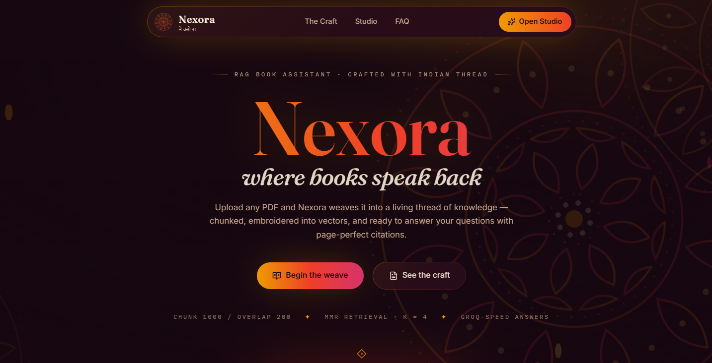
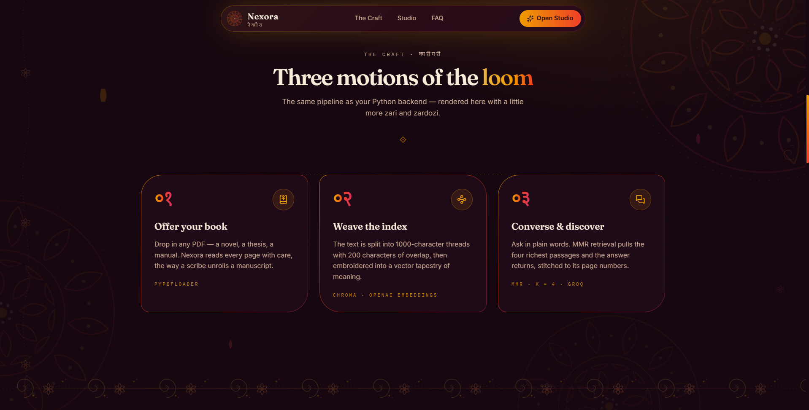
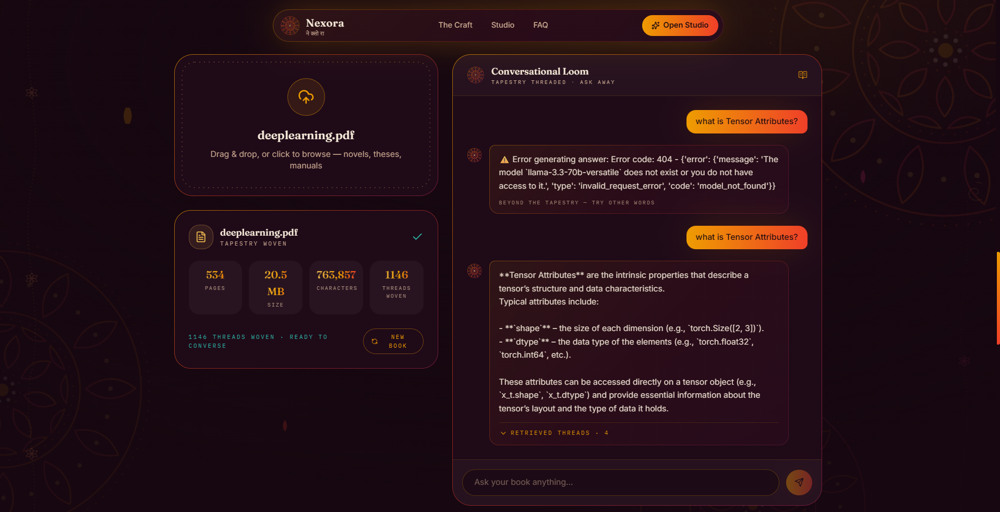
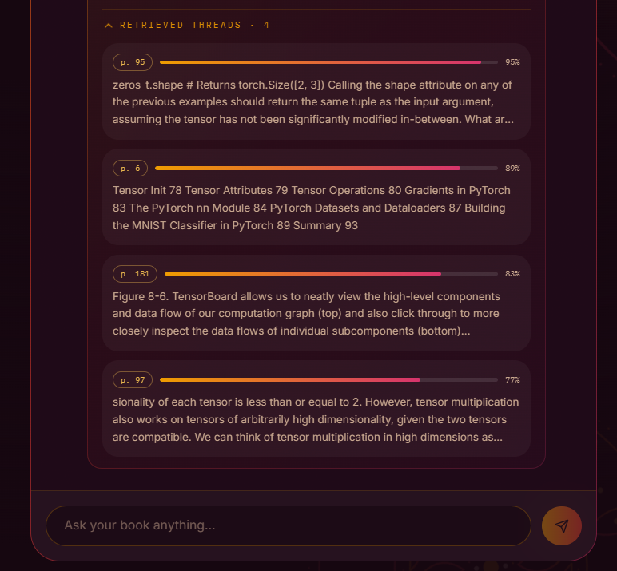

# Nexora · RAG Book Assistant 📚🪡

<div align="center">

[](https://fastapi.tiangolo.com)
[](https://python.langchain.com)
[](https://www.trychroma.com)
[](https://groq.com)
[](https://react.dev)
[](https://www.typescriptlang.org)
[](https://tailwindcss.com)
[](https://vitejs.dev)

<p align="center">
  <b>Where books speak back · एक अनोखा संवादात्मक अनुभव</b><br>
  <i>Transforming long-form manuscripts into rich, conversational tapestries with state-of-the-art RAG.</i>
</p>

</div>

---

## 🌟 Visual Tour

### 🪷 The Grand Entrance · Hero Interface
An artisan, Indian thread-inspired dark aesthetic featuring embroidered motifs, golden accents, and micro-interactions.



---

### 🧵 The Knowledge Tapestry · Pipeline Architecture
How manuscripts are unrolled, split into 1,000-character threads with 200-character seam overlaps, embedded into ChromaDB, and retrieved with Maximal Marginal Relevance (MMR).



---

### 💬 The Conversational Loom · Studio & Chat Interface
Offer a manuscript to the loom, watch the threads weave in real time, and converse with your documents naturally.



---

### 🔍 Retrieved Threads · Citations & Source Verification
Every AI response is strictly grounded in the manuscript context, showing exact book page numbers and relevance scores for instant verification.



---

## ✨ Features

- **⚡ End-to-End RAG Pipeline**:
  - **Document Ingestion**: Seamless PDF parsing powered by `PyPDFLoader`.
  - **Intelligent Chunking**: 1,000-character chunks with 200-character overlap using `RecursiveCharacterTextSplitter`.
  - **Vector Embeddings**: Dense semantic representations using OpenAI `text-embedding-3-small`.
  - **Chroma Vector Store**: Persistent local vector collection (`book_collection`).
  - **MMR Retrieval**: Maximal Marginal Relevance search (`k=4`, `fetch_k=10`, `lambda_mult=0.5`) prevents repetitive context and ensures broad source coverage.
  - **Groq LLM Acceleration**: Lightning-fast reasoning and response composition with `ChatGroq`.
- **🎯 Concept Mastery & AI Test Engine (New!)**:
  - **Generate Tests On-Demand**: Choose your topic focus (specific chapter or entire book), difficulty level (Apprentice, Weaver, Sage), and question count (3 to 10 questions).
  - **Multiple Choice Questions (MCQs)**: Contextual 4-choice questions with plausible distractors grounded directly in the text and source citations.
  - **Fill-in-the-Blank with AI Semantic Validation**: Cloze questions with missing core concept blanks. The AI validates answers semantically, rewarding correct concepts, acceptable synonyms, and partial understanding with insightful pedagogical feedback!
  - **Comprehensive Mastery Scorecard**: Radial score gauge, tier badge (*Master Sage*, *Expert Weaver*, *Apprentice*, *Seeker*), question-by-question breakdown, and one-click discussion of mistakes with the Conversational Loom.
  - **Offline & Online Resilience**: Functions 100% offline via client-side linguistic heuristics when API keys are absent, and seamlessly scales to Groq LLM intelligence when keys are provided!
- **🎨 Artisan Frontend Aesthetics**:
  - Handcrafted luxury Indian theme with jewel tones (Saffron, Gold, Sindoor, Peacock).
  - Smooth physics-based animations via Framer Motion.
  - Typewriter text effect for AI responses with animated caret.
  - Auto-detection of backend health and pre-indexed database collections.
  - Graceful fallback to client-side browser parsing when offline.
- **🚀 Unified Architecture**:
  - Single command serves both the REST API and the React production bundle from FastAPI on port `8000`.
  - Vite dev server proxy for rapid frontend development with hot-module replacement.

---

## 🚀 Quick Start

### 1. Clone & Configure Environment

```bash
git clone https://github.com/Adityahatake/Nexora-Ai.git
cd Nexora-Ai
```

Create a `.env` file in the root directory (or copy from `.env.example`):

```env
OPENAI_API_KEY=your_openai_api_key_here
GROQ_API_KEY=your_groq_api_key_here
GROQ_MODEL=openai/gpt-oss-20b
```

> **Note**: You can also use other Groq models like `llama-3.3-70b-versatile` or `llama-3.1-8b-instant`.

---

### 2. Run with Python Backend (Single Command)

Using the virtual environment:

```powershell
# Windows
.\.venv\Scripts\python.exe app.py

# macOS / Linux
source .venv/bin/activate
python app.py
```

Open your browser to:
- 🌐 **Web Interface**: [http://127.0.0.1:8000](http://127.0.0.1:8000)
- 📑 **Swagger API Docs**: [http://127.0.0.1:8000/docs](http://127.0.0.1:8000/docs)
- 🩺 **Health Check**: [http://127.0.0.1:8000/api/status](http://127.0.0.1:8000/api/status)

---

## 🛠️ Development Mode (Hot Reloading)

If you are modifying the React UI in `app/`:

1. **Start FastAPI Backend**:
   ```bash
   python app.py
   ```
2. **Start Vite Dev Server** in a separate terminal:
   ```bash
   cd app
   npx pnpm dev
   ```
   Open [http://localhost:3000](http://localhost:3000). All `/api` calls will automatically proxy to the FastAPI backend.

To build the frontend bundle manually:
```bash
cd app
npx pnpm run build
```

---

## 📡 REST API Reference

| Method | Endpoint | Description | Sample Payload |
|---|---|---|---|
| `GET` | `/api/status` | Vectorstore status, chunk count, and API key presence | — |
| `POST` | `/api/upload` | Upload & parse PDF manuscript | `multipart/form-data (file: .pdf)` |
| `POST` | `/api/index` | Weave threads & embed into Chroma DB | `{"docId": "doc_id_here"}` |
| `POST` | `/api/ask` | Retrieve relevant passages & compose AI answer | `{"question": "What is the book about?"}` |
| `POST` | `/api/reset` | Clear active session and Chroma DB | — |

---

## 📁 Repository Structure

```text
Nexora-Ai/
├── app.py                  # FastAPI Backend & RAG API server
├── app_streamlit.py        # Streamlit fallback prototype
├── create_database.py      # Standalone ingestion utility
├── requirements.txt        # Python backend dependencies
├── .env.example            # Environment variables template
├── Images/                 # Interface screenshots & diagrams
│   ├── HomePage.png
│   ├── Pipeline.png
│   ├── ChatInterface.png
│   └── RetrivedThreads.png
└── app/                    # React Frontend
    ├── index.html
    ├── vite.config.ts      # Vite build & backend proxy setup
    ├── tailwind.config.js  # Custom theme & color palette
    └── src/
        ├── sections/       # Studio, Hero, Nav, HowItWorks, Faq, Footer
        ├── components/     # UI primitives & artisan decor SVGs
        └── lib/            # apiClient.ts, rag.ts, utils.ts
```

---

<div align="center">
  <sub>Crafted with passion, Indian embroidery aesthetics, and advanced Agentic AI.</sub>
</div>
